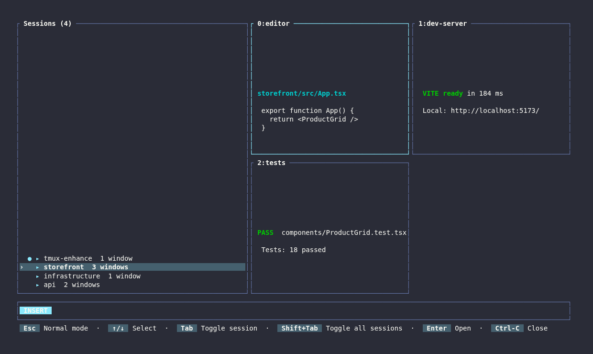

# tmux-enhance

**Navigate sessions like Telescope. Mark them like Harpoon. Know when your coding agents need you.**

[](https://github.com/dough654/tmux-enhance/actions/workflows/ci.yml)
[](https://github.com/dough654/tmux-enhance/releases/latest)
[](LICENSE)

tmux-enhance brings fast, keyboard-driven navigation and coding-agent awareness to tmux while preserving familiar tmux behavior.

- **Find anything quickly.** Search sessions and windows in one hierarchical, MRU-aware picker with live terminal previews.
- **Keep important sessions close.** Save persistent Harpoon-style marks and jump to them by number.
- **Stop babysitting agents.** See OpenCode and Claude Code activity in one place and get non-modal alerts when an agent needs permission or input.

Everything runs locally in one Rust binary. The interface follows your tmux theme, state is stored in SQLite, and agent notifications never steal focus.



<sub>Hierarchical session navigation with adaptive live previews and theme-aware colors.</sub>

## Quick start

### Requirements

- tmux 3.7 or newer
- Linux or macOS on x86_64 or ARM64
- [TPM](https://github.com/tmux-plugins/tpm)
- `curl` or `wget` for the automatic binary download

Add tmux-enhance to `~/.tmux.conf` before TPM's final `run` line:

```tmux
set -g @plugin 'dough654/tmux-enhance'

# Keep this at the bottom of .tmux.conf
run '~/.tmux/plugins/tpm/tpm'
```

Reload tmux, then press `prefix + I`. tmux-enhance detects your platform, downloads the matching release binary, verifies its SHA-256 checksum, and installs it automatically. Rust is not required.

Start with:

| Keys | Action |
| --- | --- |
| `prefix + s` | Search sessions and windows |
| `prefix + a` | View OpenCode and Claude Code agents |
| `prefix + h`, then `a` | Mark the current session |
| `prefix + h`, then `1`–`9` | Jump to a marked session |
| `prefix + Enter` | Jump to the newest agent needing attention |

`prefix + Space` remains tmux's native `next-layout` binding.

## Telescope-style navigation

Press `prefix + s` to open a unified session and window picker.

- Sessions are ordered by recent use, with the previous session prioritized.
- `Tab` expands a session to reveal its windows; `Shift + Tab` expands or collapses all sessions.
- Search reveals matching child windows without changing your saved expansion state.
- Live ANSI previews show up to four windows in an adaptive layout.
- Selecting a session preserves its active window; selecting a child jumps directly to that window.

The picker opens in insert mode so you can search immediately.

| Mode | Keys | Action |
| --- | --- | --- |
| Insert | Type | Search |
| Insert | `Up` / `Down` | Move through results |
| Insert | `Esc` | Enter normal mode |
| Normal | `j` / `k` | Move through results |
| Normal | `gg` / `G` | First / last result |
| Normal | `h` / `l` | Move through the query |
| Normal | `i`, `a`, `A`, `/` | Return to insert mode |
| Either | `Enter` | Open selection |
| Normal | `q` | Close picker |

Results flow from the bottom up, matching Telescope's visual movement.

## Harpoon-style session marks

Press `prefix + h`, then:

| Key | Action |
| --- | --- |
| `a` | Add the current session to the first free slot |
| `r` | Remove the current session |
| `o` | Open marked sessions in the picker |
| `1`–`9` | Jump directly to a slot |

Marks survive tmux restarts. Stopped sessions remain visible as unavailable until removed, and `dd` removes the selected mark from the Harpoon picker.

State is stored at `${XDG_DATA_HOME:-~/.local/share}/tmux-enhance/state.db`.

## Coding-agent awareness

Press `prefix + a` to view OpenCode and Claude Code sessions together. Statuses update live while the picker is open.

| Status | Meaning | Color |
| --- | --- | --- |
| `PROCESSING` | The agent is working | Theme accent |
| `PERMISSION` | The agent needs approval | Orange |
| `INPUT` | The agent needs an answer | Cyan |
| `READY` | The agent has finished | Green |

When an agent requests permission or input, tmux-enhance shows a compact floating notification in the top-right corner. It is non-modal: your working pane remains focused and continues receiving input.

- Click the notification to jump directly to that agent pane.
- Press `prefix + Enter` to jump to the newest unresolved agent.
- Repeated reports are deduplicated.
- Alerts are suppressed when the agent pane is already focused.
- Processing and completion reports automatically resolve stale alerts.

Clicking notifications requires tmux mouse support:

```tmux
set -g mouse on
```

### Automatic integrations

Loading tmux-enhance provisions both integrations automatically:

- **OpenCode:** registers the bundled terminal plugin in the global `cli.json`.
- **Claude Code:** registers lifecycle hooks in `~/.claude/settings.json`.

Installation is idempotent and preserves unrelated settings, plugins, and hooks.

To inspect or repair an integration, run:

```sh
~/.tmux/plugins/tmux-enhance/bin/tmux-enhance doctor
~/.tmux/plugins/tmux-enhance/bin/tmux-enhance opencode status \
  --plugin-dir ~/.tmux/plugins/tmux-enhance/opencode
~/.tmux/plugins/tmux-enhance/bin/tmux-enhance claude-code status
```

## Configuration

Set options before the tmux-enhance plugin line in `~/.tmux.conf`.

### Interface and notifications

| Option | Default | Description |
| --- | --- | --- |
| `@enhance-picker-width` | `90%` | Picker popup width |
| `@enhance-picker-height` | `80%` | Picker popup height |
| `@enhance-toast-duration` | `4` | Harpoon toast duration in seconds |
| `@enhance-alerts` | `on` | Enable proactive agent alerts |
| `@enhance-alert-overlay` | `on` | Show floating alert panes |
| `@enhance-alert-duration` | `15` | Alert lifetime in seconds |
| `@enhance-alert-width` | `50` | Alert width in columns |
| `@enhance-alert-height` | `6` | Alert height in rows |
| `@enhance-alert-ready` | `off` | Notify when processing finishes |
| `@enhance-alert-bell` | `off` | Ring the terminal bell for alerts |
| `@enhance-alert-native` | `off` | Also call host `notify-send` |
| `@enhance-auto-install` | `on` | Download verified release binaries automatically |
| `@enhance-bin` | Auto-detected | Use a custom tmux-enhance binary |

Example:

```tmux
set -g @enhance-alert-duration 20
set -g @enhance-alert-ready 'on'
set -g @enhance-picker-width '85%'
set -g @plugin 'dough654/tmux-enhance'
```

### Theme integration

tmux-enhance derives its canvas, foreground, borders, selection, and semantic agent colors from tmux's resolved styles. It works with theme plugins without theme-specific configuration.

<details>
<summary>Override individual colors</summary>

```tmux
set -g @enhance-color-background '#282c34'
set -g @enhance-color-foreground '#abb2bf'
set -g @enhance-color-accent '#61afef'
set -g @enhance-color-border '#5c6370'
set -g @enhance-color-selection-background '#3e4451'
set -g @enhance-color-selection-foreground '#ffffff'
set -g @enhance-color-normal-mode-background '#e5c07b'
set -g @enhance-color-normal-mode-foreground '#282c34'
set -g @enhance-color-agent-processing '#6272a4'
set -g @enhance-color-agent-permission '#e5a84b'
set -g @enhance-color-agent-input '#2878b8'
set -g @enhance-color-agent-ready '#15803d'
```

</details>

## Platform support

| Platform | Architectures | Distribution |
| --- | --- | --- |
| Linux | x86_64, ARM64 | Statically linked musl binaries |
| macOS 11+ | Intel, Apple Silicon | Native binaries |
| Windows | x86_64 or ARM64 through WSL | Corresponding Linux binary |

Native Windows is not supported because tmux requires a Unix-like environment. Every tagged release is built, tested, and smoke-tested on all four native targets before publication.

## Other installation methods

<details>
<summary>Install a release archive manually</summary>

Download the archive for your platform and `SHA256SUMS` from the [latest release](https://github.com/dough654/tmux-enhance/releases/latest), verify it, and extract it into `~/.tmux/plugins/tmux-enhance`.

Release archives contain the complete plugin and do not require Rust. Load the extracted plugin with:

```tmux
run-shell '~/.tmux/plugins/tmux-enhance/tmux-enhance.tmux'
```

</details>

<details>
<summary>Build from source</summary>

```sh
git clone https://github.com/dough654/tmux-enhance.git ~/.tmux/plugins/tmux-enhance
cd ~/.tmux/plugins/tmux-enhance
cargo build --release
```

Then add this to `~/.tmux.conf`:

```tmux
run-shell '~/.tmux/plugins/tmux-enhance/tmux-enhance.tmux'
```

</details>

## Troubleshooting

Run the built-in diagnostics:

```sh
~/.tmux/plugins/tmux-enhance/bin/tmux-enhance doctor
```

If automatic binary installation fails, run the installer directly to see the full error:

```sh
~/.tmux/plugins/tmux-enhance/scripts/install-binary.sh
```

Common requirements are tmux 3.7+, network access to GitHub Releases, `curl` or `wget`, `tar`, and a SHA-256 tool (`sha256sum`, `shasum`, or `openssl`).

## Contributing

Issues and pull requests are welcome. CI checks formatting, tests, strict Clippy, shell and JavaScript syntax, release version consistency, and the optimized Rust build.

## License

tmux-enhance is open source under the [MIT License](LICENSE).
